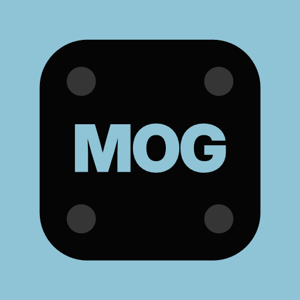
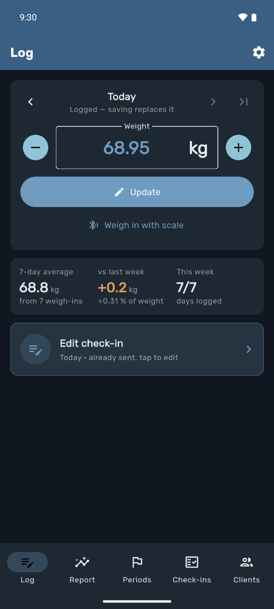
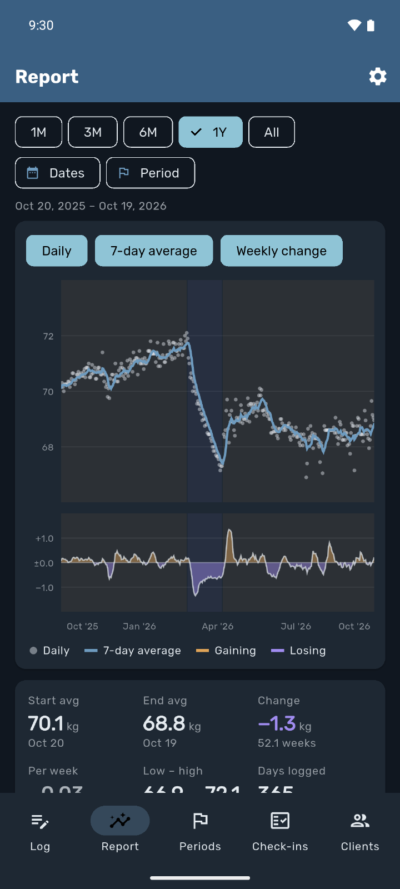
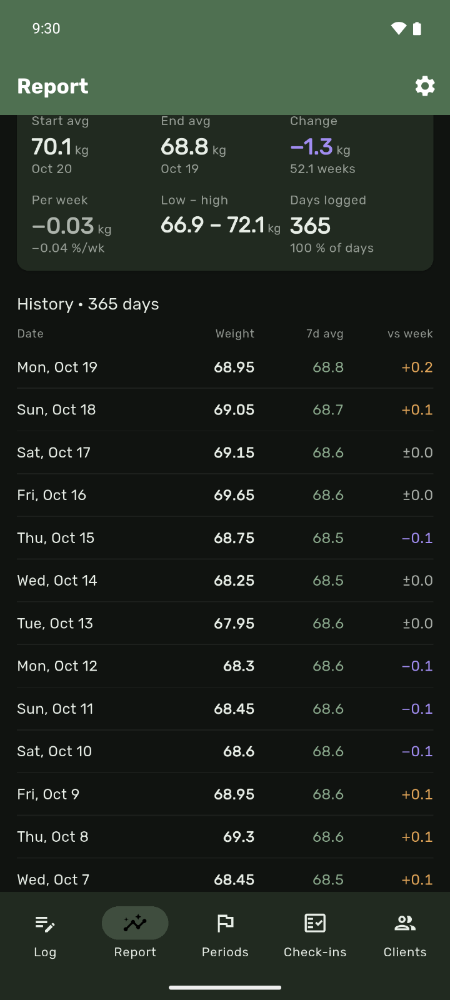
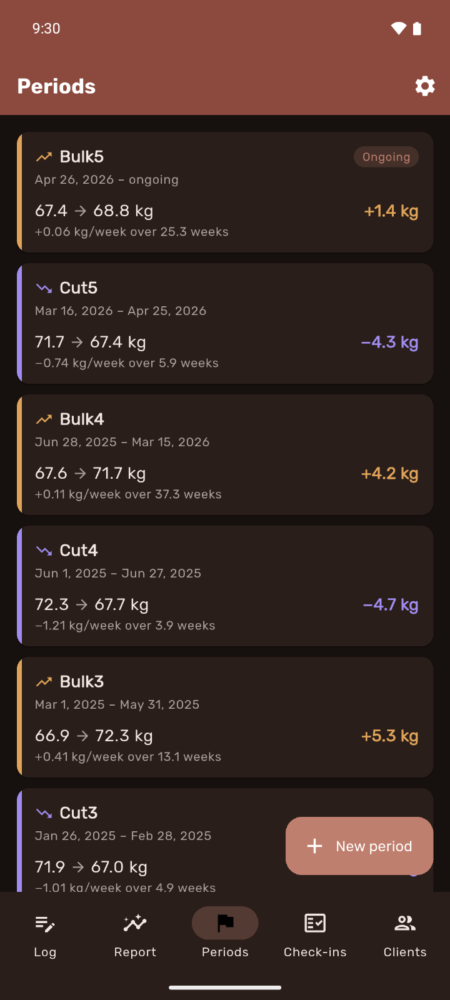
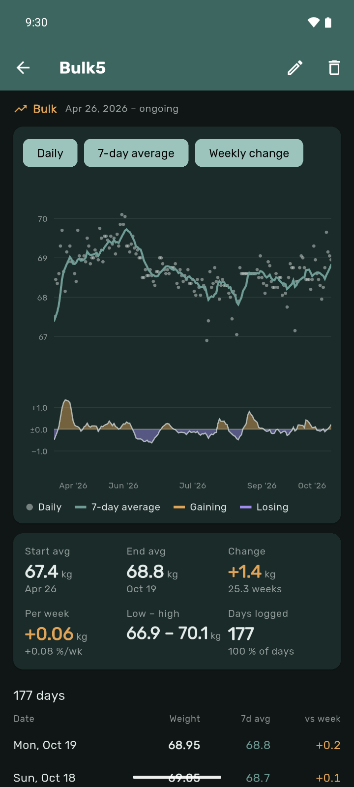
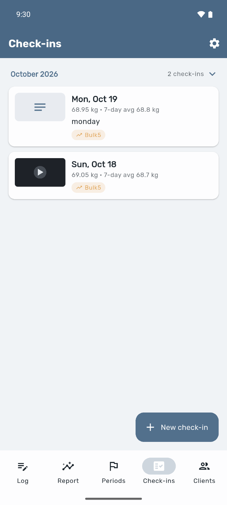
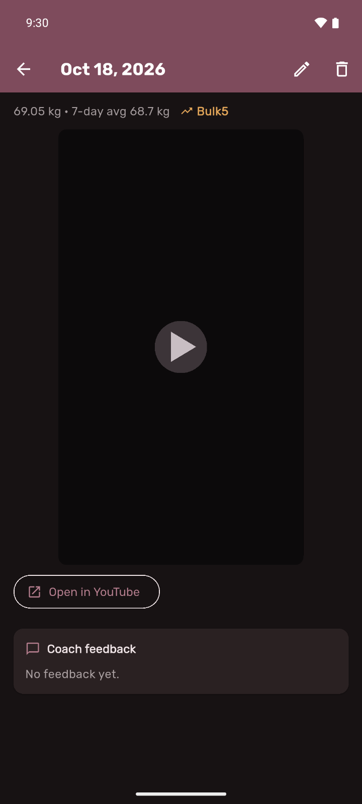
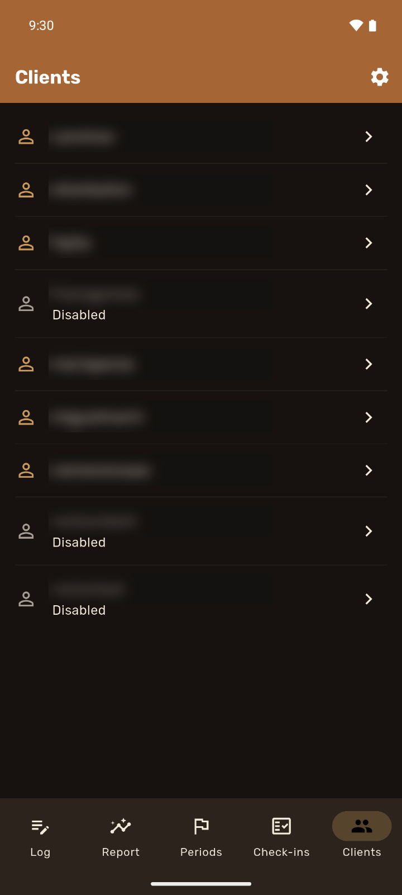

# WeightMog

### Bodyweight tracking that shows the trend, not the noise.

Log one weight a day. WeightMog turns it into a **rolling 7-day average** and a
**week-on-week change**, groups your weeks into **cut, bulk and maintenance
periods**, and lets you send your coach **check-ins** with a video and a note.
Part of the Mog family — **same account as StrengthMog**, in **English and
Spanish**.

**[⬇️ Download the latest release →](../../releases/latest)**
&nbsp;·&nbsp;
**[▶️ Or use it in your browser →](https://strengthmog.web.app/weightmog/app/)**

---

## 📲 Download & install

This repository hosts the official Android builds. Grab one from the
**[latest release](../../releases/latest)**:

| Build | Size | Who it's for |
|-------|------|--------------|
| **`WeightMog-arm64.apk`** | ~30 MB | **Almost everyone** — phones from ~2017 onward (arm64-v8a) |
| `WeightMog-universal.apk` | ~86 MB | Older 32-bit or non-standard devices; installs on anything |

**Installing the APK** (sideload):

1. Download the APK to your Android phone.
2. Open it — Android will ask to allow installing from this source the first
   time. Enable **“Install unknown apps”** for your browser/files app.
3. Tap **Install**, then open WeightMog and sign in with the same ID you use
   in StrengthMog.

The app tells you when a new version is out — tap **Update** and it downloads
the new APK.

> 🔒 WeightMog uses your Mog account. If you don't have one yet, see
> [Getting an account](#-getting-an-account).

### 🍎 iPhone, iPad or desktop — no install

The full app also runs in the browser at
**[strengthmog.web.app/weightmog/app](https://strengthmog.web.app/weightmog/app/)**
with the same account and the same data. On iOS, open it in Safari and tap
**Share → Add to Home Screen** to get a full-screen icon just like a native app.

---

## ✨ A quick look

  
  
  
  

  
  
  
  

Shown in Slate Blue, Sage, Clay, Muted Teal, Slate Light, Dusty Rose and Amber Earth — 7 of the 12 built-in themes.

---

## ⚖️ What's inside

**Log in seconds**
- Today's weight with **±0.1 steppers** that start from yesterday's number —
  and back-fill a missed day just as fast.
- **Weigh in with a Bluetooth scale** (Android): step on a Xiaomi Mi Scale /
  Mi Body Composition Scale and WeightMog reads the number. Nothing pairs, so
  the scale keeps syncing with Zepp Life too.

**See the real trend**
- A **7-day rolling average** and the **change vs 7 days earlier** — the
  numbers that actually move, so one salty dinner doesn't ruin your week.
- A **Report** for 1M / 3M / 6M / 1Y / All, a custom range or any period:
  daily weigh-ins and the average on one chart, the weekly change underneath,
  your periods shaded behind them.
- Start/end average, total change, **kg and % per week**, low–high and days
  logged — plus the full day-by-day history, editable in place.

**Cut, bulk, maintain**
- Mark each phase as a **cut, bulk, maintenance or custom period** —
  open-ended while it's ongoing, with an optional **goal weight**.
- Each period gets its own chart, weekly rate, goal line and an **ETA** to
  the goal.

**Check-ins with your coach**
- A dated **check-in** with a **video link** and/or a note, shown with that
  day's weight, average and period.
- YouTube, Google Drive, Vimeo and Loom videos **play inside the app**.
- Your coach answers with **feedback** right under it.

**For coaches**
- A **Clients** tab with everyone you coach: their Report, Periods and
  Check-ins, and feedback on every check-in.
- Access follows the client's **current coach** — change coach and the new one
  sees the full history at once.

**In the app**
- **Bring your history** — import a Google Sheets export (.xlsx with every
  tab, or .csv); old tabs like `Cut1` / `Bulk4.2` become periods.
- **One account for every Mog app** — your weights also show up in
  StrengthMog, and **Settings → Mog apps** gets you the others.
- **Make it yours** — 8 dark and 4 light themes and a choice of fonts, fully
  localized in English and Spanish.

---

## 🎟️ Getting an account

WeightMog signs in with your **Mog account** — the same ID and password as
StrengthMog. Accounts are created by a coach for their clients; if you train
with a coach who uses StrengthMog, you already have one.

Interested in coaching your clients with the Mog apps?
📧 **[elvsbyt@live.com](mailto:elvsbyt@live.com?subject=WeightMog%20coaching%20subscription)**

---

## 📄 License

WeightMog is **proprietary software** — © 2026 Víctor Segura, all rights
reserved. The binaries here are provided only so authorized users can install
the app. No rights to the source code are granted. See [LICENSE](LICENSE).
